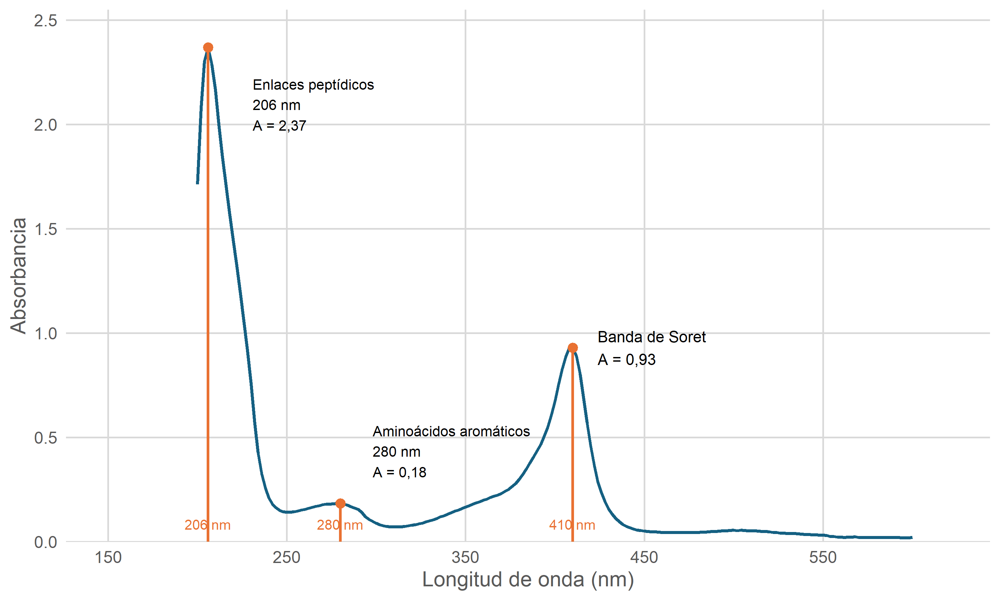
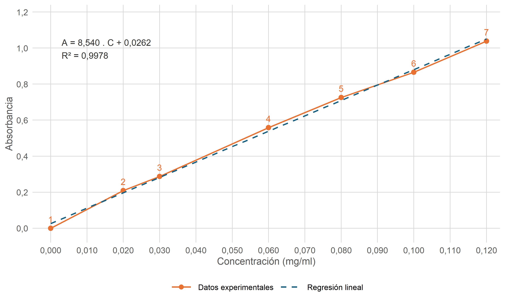
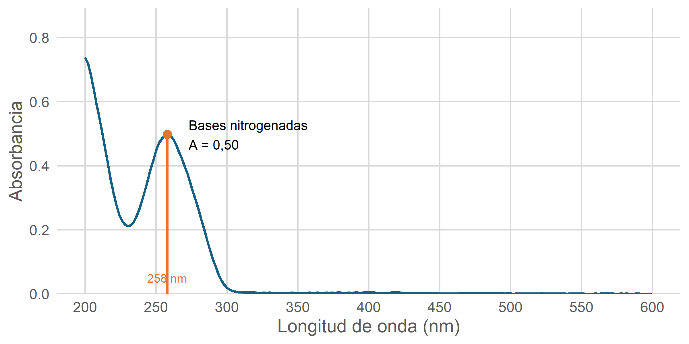
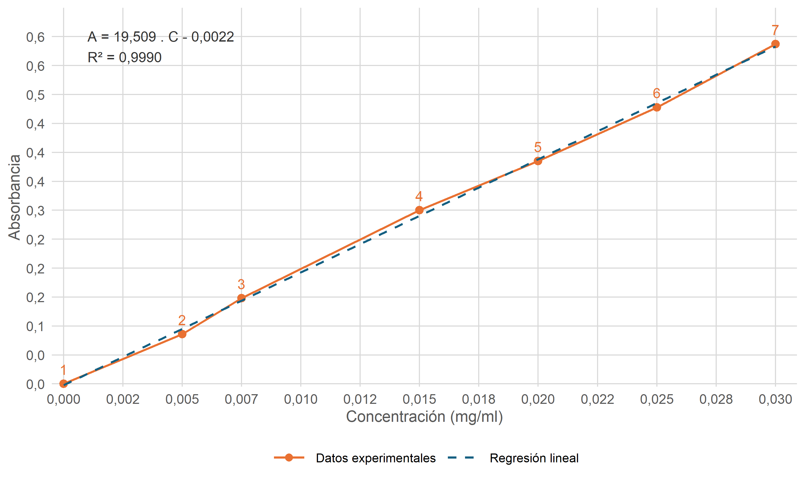
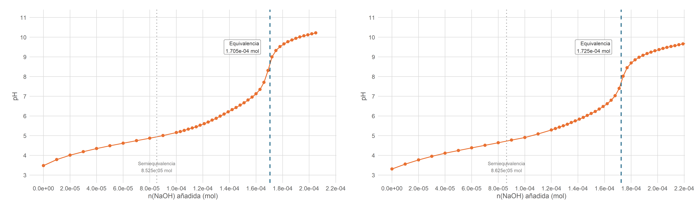
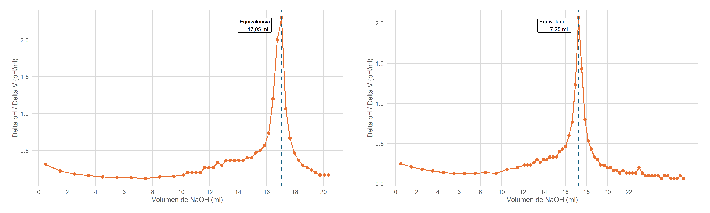
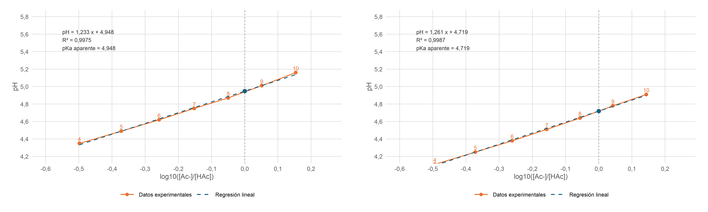

```{r include=FALSE}
fig_id <- 0
tbl_id <- 0
```
# Práctica 1: Espectrofotometría ultravioleta (UV)-visible de proteínas, nucleótidos y ácidos nucleicos

## Muestra 1 - mioglobina
```{r include=FALSE}
library(ggplot2)
library(readr)
library(dplyr)

# Load experimental data
df <- read_csv2(
  file.path("1_Espectrofotometria/mioglobina.csv"),
  show_col_types = FALSE
)

names(df) <- c("wavelength", "absorbance")

# Ensure numeric values
df$wavelength <- as.numeric(df$wavelength)
df$absorbance <- as.numeric(df$absorbance)

# Find maximum absorbance in a wavelength interval
find_peak <- function(data, xmin, xmax) {
  region <- data %>%
    filter(
      wavelength >= xmin,
      wavelength <= xmax,
      !is.na(absorbance)
    )

  if (nrow(region) == 0) {
    stop(paste("No data between", xmin, "and", xmax, "nm"))
  }

  region %>%
    slice_max(absorbance, n = 1, with_ties = FALSE)
}

# Detect peaks
peptide_peak  <- find_peak(df, 190, 230)
aromatic_peak <- find_peak(df, 260, 300)
soret_peak    <- find_peak(df, 380, 430)

# Combine peak data
peaks <- bind_rows(
  mutate(peptide_peak, type = "Peptide"),
  mutate(aromatic_peak, type = "Aromatic"),
  mutate(soret_peak, type = "Soret")
)

print(peaks)

# Labels with decimal commas
format_abs <- function(x) {
  format(round(x, 2), nsmall = 2, decimal.mark = ",")
}

# Plot
p_mio_espectro <- ggplot(df, aes(x = wavelength, y = absorbance)) +

  # Experimental spectrum
  geom_line(
    color = "#156082",
    linewidth = 1.1
  ) +

  # Vertical reference lines (no point on X-axis)
  geom_segment(
    data = peaks,
    aes(
      x = wavelength,
      xend = wavelength,
      y = 0,
      yend = absorbance
    ),
    inherit.aes = FALSE,
    color = "#E97132",
    linewidth = 0.9
  ) +

  # Mark only the absorption maxima
  geom_point(
    data = peaks,
    aes(x = wavelength, y = absorbance),
    inherit.aes = FALSE,
    color = "#E97132",
    size = 2.8
  ) +

  # Peptide bond annotation
  annotate(
    "text",
    x = peptide_peak$wavelength + 25,
    y = peptide_peak$absorbance - 0.15,
    label = paste0(
      "Enlaces peptídicos\n",
      round(peptide_peak$wavelength), " nm\n",
      "A = ", format_abs(peptide_peak$absorbance)
    ),
    hjust = 0,
    vjust = 1,
    size = 3.6
  ) +

  # Aromatic amino acid annotation
  annotate(
    "text",
    x = aromatic_peak$wavelength + 18,
    y = aromatic_peak$absorbance + 0.25,
    label = paste0(
      "Aminoácidos aromáticos\n",
      round(aromatic_peak$wavelength), " nm\n",
      "A = ", format_abs(aromatic_peak$absorbance)
    ),
    hjust = 0,
    size = 3.6
  ) +

  # Soret peak absorbance
  annotate(
    "text",
    x = soret_peak$wavelength + 14,
    y = soret_peak$absorbance,
    label = paste0(
      "Banda de Soret\n",
      "A = ", format_abs(soret_peak$absorbance)
    ),
    hjust = 0,
    size = 4
  ) +

  # Wavelength labels at bottom, without orange points
  geom_text(
    data = peaks,
    aes(
      x = wavelength,
      y = 0,
      label = paste0(round(wavelength), " nm")
    ),
    inherit.aes = FALSE,
    vjust = -1.2,
    size = 3.5,
    color = "#E97132"
  ) +

  # Axes
  scale_x_continuous(
    limits = c(150, 620),
    breaks = seq(150, 600, 100),
    minor_breaks = seq(150, 620, 20)
  ) +

  scale_y_continuous(
    limits = c(0, 2.5),
    breaks = seq(0, 2.5, 0.5),
    expand = expansion(mult = c(0, 0.02))
  ) +

  labs(
    x = "Longitud de onda (nm)",
    y = "Absorbancia"
  ) +

  theme_minimal(base_size = 14) +

  theme(
    plot.title = element_text(
      size = 18,
      hjust = 0.5,
      color = "#595959",
      margin = margin(b = 25)
    ),
    axis.title = element_text(
      size = 15,
      color = "#595959"
    ),
    axis.text = element_text(
      size = 12,
      color = "#595959"
    ),
    panel.grid.major = element_line(
      color = "#D9D9D9",
      linewidth = 0.6
    ),
    panel.grid.minor = element_blank(),
    panel.border = element_blank()
  )

print(p_mio_espectro)

ggsave(
  "1_Espectrofotometria/mioglobina_espectro.png",
  plot = p_mio_espectro,
  width = 10,
  height = 6,
  dpi = 300,
  bg = "white"
)
```

```{r include=FALSE}
fig_id <- fig_id + 1
```

```{r mioglobina-espectro, echo=FALSE, fig.align='center', fig.cap=paste0('Figura ', fig_id, ': Espectro de absorción UV-visible de mioglobina equina a 0,1 mg/mL.')}

```

```{r include=FALSE}
library(ggplot2)
library(readr)
library(dplyr)

# 1 = Tubo
# 5 = Concentración
# 6 = Absorbancia medida

df <- read_csv2(
  file.path("1_Espectrofotometria/mioglobina_data_experimental.csv"),
  show_col_types = FALSE
)

data_mio <- df %>%
  transmute(
    tubo = as.integer(.data[[names(df)[1]]]),
    concentracion = as.numeric(.data[[names(df)[5]]]),
    absorbancia = as.numeric(.data[[names(df)[6]]])
  ) %>%
  filter(tubo >= 1, tubo <= 7) %>%
  arrange(tubo)

modelo <- lm(
  absorbancia ~ concentracion,
  data = data_mio
)

pendiente <- unname(coef(modelo)[2])
intercepto <- unname(coef(modelo)[1])
r2 <- summary(modelo)$r.squared

fmt <- function(x, n = 3) {
  formatC(
    x,
    format = "f",
    digits = n,
    decimal.mark = ","
  )
}

signo <- ifelse(intercepto >= 0, " + ", " - ")

ecuacion <- paste0(
  "A = ", fmt(pendiente, 3), " . C",
  signo, fmt(abs(intercepto), 4),
  "\nR² = ", fmt(r2, 4)
)

print(summary(modelo))
cat(ecuacion, "\n")

data_mio

p_mio <- ggplot(
  data_mio,
  aes(x = concentracion, y = absorbancia)
) +

  geom_line(
    aes(color = "Datos experimentales"),
    linewidth = 0.9
  ) +

  geom_point(
    aes(color = "Datos experimentales"),
    size = 3
  ) +

  geom_smooth(
    aes(color = "Regresión lineal"),
    method = "lm",
    formula = y ~ x,
    se = FALSE,
    linewidth = 1,
    linetype = "dashed"
  ) +

  scale_color_manual(
    name = NULL,
    values = c(
      "Datos experimentales" = "#E97132",
      "Regresión lineal" = "#156082"
    ),
    breaks = c(
      "Datos experimentales",
      "Regresión lineal"
    ),
    guide = guide_legend(
      override.aes = list(
        linetype = c("solid", "dashed"),
        shape = c(16, NA)
      )
    )
  ) +

  geom_text(
    aes(label = tubo),
    nudge_y = 0.05,
    size = 4.5,
    color = "#E97132"
  ) +

  annotate(
    "text",
    x = 0.003,
    y = 1.05,
    label = ecuacion,
    hjust = 0,
    vjust = 1,
    size = 4.5,
    color = "#333333"
  ) +

  scale_x_continuous(
    breaks = seq(0, 0.12, 0.01),
    labels = function(x) fmt(x, 3),
    expand = expansion(mult = c(0, 0.03))
  ) +

  scale_y_continuous(
    breaks = seq(0, 1.2, 0.2),
    labels = function(y) fmt(y, 1),
    expand = expansion(mult = c(0, 0))
  ) +

  coord_cartesian(
    xlim = c(-0.005, 0.12),
    ylim = c(-0.08, 1.24),
    clip = "off"
  ) +

  labs(
    x = "Concentración (mg/ml)",
    y = "Absorbancia",
  ) +

  # Estilo
  theme_minimal(base_size = 14) +

  theme(
    plot.title = element_text(
      size = 18,
      hjust = 0.5,
      color = "#595959"
    ),
    plot.subtitle = element_text(
      hjust = 0.5,
      color = "#777777"
    ),
    axis.title = element_text(
      size = 14,
      color = "#595959"
    ),
    axis.text = element_text(
      size = 12,
      color = "#595959"
    ),
    panel.grid.major = element_line(
      color = "#D9D9D9",
      linewidth = 0.5
    ),
    panel.grid.minor = element_blank(),
    plot.caption = element_text(
      size = 10,
      hjust = 0.5
    ),
    legend.position = "bottom",
    legend.title = element_blank(),
    legend.text = element_text(size = 11),
    legend.key.width = grid::unit(1.2, "cm")
  )

p_mio

ggsave(
  "1_Espectrofotometria/recta_patron_mioglobina.png",
  plot = p_mio,
  width = 10,
  height = 6,
  dpi = 300,
  bg = "white"
)
```

```{r tabla-mioglobina, echo=FALSE, results='asis'}
tbl_id <- tbl_id + 1
knitr::kable(
  df,
  caption = paste0('Tabla ', tbl_id, ': Datos medidos experimentalmente.'),
  digits = 3,
  align = "c",
  row.names = FALSE
)
```

```{r include=FALSE}
fig_id <- fig_id + 1
```

```{r fig-adn-recta-mioglobina, echo=FALSE, fig.align='center', fig.cap=paste0('Figura ', fig_id, ': Recta patrón de mioglobina obtenida a partir de los tubos 1–7.')}

```

Para determinar experimentalmente el coeficiente de extinción molar de la mioglobina equina, se utilizaron los siete primeros tubos patrón, con concentraciones entre 0 y 0,12 mg/mL, suponiendo un paso óptico de 1 cm y una masa molecular aproximada de 17.000 g/mol. Mediante regresión lineal se obtuvo la ecuación A = 8,53985.c + 0,02624, con un coeficiente de determinación R² = 0,99783, y un coeficiente de extinción molar de 145.178 L.mol⁻¹.cm⁻¹. Al realizar una regresión forzada al origen 0 se obtuvo un coeficiente de 150.300 L.mol⁻¹.cm⁻¹. Finalmente, aplicando directamente la ley de Lambert-Beer al tubo 6 (A = 0,866; c = 0,1 mg/mL), se obtuvo un valor de 147.220 L.mol⁻¹.cm⁻¹. Los tres resultados fueron próximos entre sí y se compararon con el valor bibliográfico de 157.000 L.mol⁻¹.cm⁻¹ para mioglobina equina férrica a 409 nm y pH 7,0 [@desanctis2007], obteniéndose diferencias relativas del −7,53 %, −4,27 % y −6,23 %, respectivamente. Estas diferencias pueden estar relacionadas con la incertidumbre experimental, el procedimiento de ajuste y las condiciones de medida. En conjunto, los resultados presentan una buena concordancia con la referencia seleccionada y son compatibles con la ley de Lambert-Beer en el intervalo estudiado.

Recalculando las absorbancias esperadas mediante la ley de Lambert-Beer y utilizando el coeficiente de extinción molar experimental que presenta la menor desviación respecto al valor bibliográfico (150.300 L.mol⁻¹.cm⁻¹), se obtuvieron los valores que se muestran en la siguiente tabla.
```{r tabla-recalculo-mioglobina-m, echo=FALSE, results='asis'}
epsilon <- 150300   # L mol-1 cm-1
teorico <- 157000   # L mol-1 cm-1
PM <- 17000         # g/mol
l <- 1              # cm

data_mio_todo <- df %>%
  transmute(
    tubo = as.integer(.data[[names(df)[1]]]),
    concentracion = as.numeric(.data[[names(df)[5]]]),
    absorbancia = as.numeric(.data[[names(df)[6]]])
  ) %>%
  filter(tubo >= 1, tubo <= 10) %>%
  arrange(tubo)

# Calcular absorbancias esperadas
tabla_abs <- data_mio_todo %>%
  mutate(
    concentracion_molar = concentracion / PM,
    absorbancia_esperada = epsilon * concentracion_molar * l,
    absorbancia_esperada_teorica = teorico * concentracion_molar * l,
    diferencia = as.integer(((absorbancia - absorbancia_esperada)/absorbancia_esperada)*10000)/100
  ) %>%
  select(
    tubo,
    concentracion,
    absorbancia,
    absorbancia_esperada,
    absorbancia_esperada_teorica,
    diferencia
  )

tbl_id <- tbl_id + 1
knitr::kable(
  tabla_abs,
  col.names = c(
    "Tubo",
    "Concentración (mg/mL)",
    "Absorbancia medida",
    "Absorbancia esperada lineal",
    "Absorbancia esperada teorica (usando epsilon = 157000)",
    "Diferencia en % (medida - esperada lineal)"
  ),
  digits = 4,
  align = "c",
  row.names = FALSE,
  caption = paste0('Tabla ', tbl_id, ': Comparación entre las absorbancias experimentales y las calculadas mediante la ley de Lambert-Beer.'),
)
```

Para las muestras preparadas con 1 mL de mioglobina 5× (tubo 8) y con 0,5 mL de mioglobina 5× y 0,5 mL de tampón (tubo 9), el espectrofotómetro indicó valores de absorbancia superiores a 3, fuera de su rango de medida. A estas absorbancias tan elevadas, las mediciones no serían suficientemente fiables para su cuantificación y, por tanto, no fue posible determinar experimentalmente la concentración de estas disoluciones a partir de sus absorbancias. No obstante, utilizando el coeficiente de extinción molar determinado experimentalmente (150.300 L.mol⁻¹.cm⁻¹) y las concentraciones nominales conocidas, se calcularon las absorbancias esperadas de 8,84 y 4,42, respectivamente. Ambos valores superan el rango de medida del instrumento, lo que concuerda con los resultados observados.

En el caso de la muestra preparada con 0,1 mL de mioglobina 5× y 0,9 mL de tampón, la absorbancia esperada debería ser equivalente a la del tubo 6 (A = 0,866), ya que ambas muestras presentan la misma concentración final de mioglobina. Sin embargo, se observó una desviación mayor de -13.47% respecto al valor esperado, posiblemente debida a errores de pipeteo y a la acumulación de errores durante la preparación de las diluciones sucesivas.

## Muestra 2 - ADN
```{r include=FALSE}
library(ggplot2)
library(readr)
library(dplyr)

adn <- read_csv2(
  file.path("1_Espectrofotometria/adn.csv"),
  show_col_types = FALSE
)

names(adn) <- c("wavelength", "absorbance")

adn$wavelength <- as.numeric(adn$wavelength)
adn$absorbance <- as.numeric(adn$absorbance)

region <- adn %>%
  filter(
    wavelength >= 240,
    wavelength <= 280,
    !is.na(absorbance)
  )

stopifnot(nrow(region) > 0)

peak <- region %>%
  slice_max(absorbance, n = 1, with_ties = FALSE)

print(peak)

p_adn <- ggplot(
  adn,
  aes(x = wavelength, y = absorbance)
) +

  geom_line(
    color = "#156082",
    linewidth = 1.1
  ) +

  geom_segment(
    data = peak,
    aes(
      x = wavelength,
      xend = wavelength,
      y = 0,
      yend = absorbance
    ),
    inherit.aes = FALSE,
    color = "#E97132",
    linewidth = 1
  ) +

  # Point only at the maximum
  geom_point(
    data = peak,
    aes(x = wavelength, y = absorbance),
    inherit.aes = FALSE,
    color = "#E97132",
    size = 3
  ) +

  # Absorbance annotation
  annotate(
    "text",
    x = peak$wavelength + 15,
    y = peak$absorbance,
    label = paste0(
      "Bases nitrogenadas\n",
      "A = ",
      format(
        round(peak$absorbance, 2),
        decimal.mark = ",",
        nsmall = 2
      )
    ),
    hjust = 0,
    size = 4
  ) +

  # Wavelength label near X-axis
  annotate(
    "text",
    x = peak$wavelength,
    y = 0,
    label = paste0(
      round(peak$wavelength),
      " nm"
    ),
    vjust = -1.3,
    color = "#E97132",
    size = 3.5
  ) +

  # Axes
  scale_x_continuous(
    breaks = seq(200, 700, 50),
    minor_breaks = seq(200, 700, 10)
  ) +

  scale_y_continuous(
    breaks = scales::breaks_pretty(n = 6),
    expand = expansion(mult = c(0, 0.05))
  ) +

  coord_cartesian(ylim = c(
    0,
    max(adn$absorbance, na.rm = TRUE) * 1.15
  )) +

  labs(
    x = "Longitud de onda (nm)",
    y = "Absorbancia"
  ) +

  theme_minimal(base_size = 14) +

  theme(
    plot.title = element_text(
      size = 18,
      hjust = 0.5,
      color = "#595959",
      margin = margin(b = 25)
    ),
    axis.title = element_text(
      size = 15,
      color = "#595959"
    ),
    axis.text = element_text(
      size = 12,
      color = "#595959"
    ),
    panel.grid.major = element_line(
      color = "#D9D9D9",
      linewidth = 0.6
    ),
    panel.grid.minor = element_blank(),
    panel.border = element_blank()
  )

ggsave(
 file.path("1_Espectrofotometria/adn_espectro.png"),
 plot = p_adn,
 width = 8,
 height = 4,
 dpi = 300
)
```

```{r include=FALSE}
fig_id <- fig_id + 1
```

```{r adn-espectro, echo=FALSE, fig.align='center', fig.cap=paste0('Figura ', fig_id, ': Espectro de absorción UV-visible de ADN a 0,025 mg/mL.')}

```

```{r include=FALSE}
library(ggplot2)
library(readr)
library(dplyr)

# 1 = Tubo
# 5 = Concentración
# 6 = Absorbancia medida

df <- read_csv2(
  file.path("1_Espectrofotometria/adn_data_experimental.csv"),
  show_col_types = FALSE
)

data_mio <- df %>%
  transmute(
    tubo = as.integer(.data[[names(df)[1]]]),
    concentracion = as.numeric(.data[[names(df)[5]]]),
    absorbancia = as.numeric(.data[[names(df)[6]]])
  ) %>%
  filter(tubo >= 1, tubo <= 7) %>%
  arrange(tubo)

modelo <- lm(
  absorbancia ~ concentracion,
  data = data_mio
)

pendiente <- unname(coef(modelo)[2])
intercepto <- unname(coef(modelo)[1])
r2 <- summary(modelo)$r.squared

fmt <- function(x, n = 3) {
  formatC(
    x,
    format = "f",
    digits = n,
    decimal.mark = ","
  )
}

signo <- ifelse(intercepto >= 0, " + ", " - ")

ecuacion <- paste0(
  "A = ", fmt(pendiente, 3), " . C",
  signo, fmt(abs(intercepto), 4),
  "\nR² = ", fmt(r2, 4)
)

print(summary(modelo))
cat(ecuacion, "\n")

data_mio

p_mio <- ggplot(
  data_mio,
  aes(x = concentracion, y = absorbancia)
) +

  geom_line(
    aes(color = "Datos experimentales"),
    linewidth = 0.9
  ) +

  geom_point(
    aes(color = "Datos experimentales"),
    size = 3
  ) +

  geom_smooth(
    aes(color = "Regresión lineal"),
    method = "lm",
    formula = y ~ x,
    se = FALSE,
    linewidth = 1,
    linetype = "dashed"
  ) +

  scale_color_manual(
    name = NULL,
    values = c(
      "Datos experimentales" = "#E97132",
      "Regresión lineal" = "#156082"
    ),
    breaks = c(
      "Datos experimentales",
      "Regresión lineal"
    ),
    guide = guide_legend(
      override.aes = list(
        linetype = c("solid", "dashed"),
        shape = c(16, NA)
      )
    )
  ) +

  geom_text(
    aes(label = tubo),
    nudge_y = 0.025,
    size = 4.5,
    color = "#E97132"
  ) +

  annotate(
    "text",
    x = 0.001,
    y = 0.61,
    label = ecuacion,
    hjust = 0,
    vjust = 1,
    size = 4.5,
    color = "#333333"
  ) +

  scale_x_continuous(
    breaks = seq(0, 0.12, 0.0025),
    labels = function(x) fmt(x, 3),
    expand = expansion(mult = c(0, 0.03))
  ) +

  scale_y_continuous(
    breaks = seq(0, 0.6, 0.05),
    labels = function(y) fmt(y, 1),
    expand = expansion(mult = c(0, 0))
  ) +

    
  coord_cartesian(
    xlim = c(-0.0005, 0.03),
    ylim = c(-0.005, 0.65),
    clip = "off"
  ) +

  labs(
    x = "Concentración (mg/ml)",
    y = "Absorbancia",
  ) +

  # Estilo
  theme_minimal(base_size = 14) +

  theme(
    plot.title = element_text(
      size = 18,
      hjust = 0.5,
      color = "#595959"
    ),
    plot.subtitle = element_text(
      hjust = 0.5,
      color = "#777777"
    ),
    axis.title = element_text(
      size = 14,
      color = "#595959"
    ),
    axis.text = element_text(
      size = 12,
      color = "#595959"
    ),
    panel.grid.major = element_line(
      color = "#D9D9D9",
      linewidth = 0.5
    ),
    panel.grid.minor = element_blank(),
    plot.caption = element_text(
      size = 10,
      hjust = 0.5
    ),
    legend.position = "bottom",
    legend.title = element_blank(),
    legend.text = element_text(size = 11),
    legend.key.width = grid::unit(1.2, "cm")
  )

p_mio

ggsave(
  "1_Espectrofotometria/recta_patron_adn.png",
  plot = p_mio,
  width = 10,
  height = 6,
  dpi = 300,
  bg = "white"
)
```

```{r tabla-adn, echo=FALSE, results='asis'}
tbl_id <- tbl_id + 1
knitr::kable(
  df,
  caption = paste0('Tabla ', tbl_id, ': Datos medidos experimentalmente.'),
  digits = 3,
  align = "c",
  row.names = FALSE
)
```

```{r include=FALSE}
fig_id <- fig_id + 1
```

```{r fig-adn-recta-patron, echo=FALSE, fig.align='center', fig.cap=paste0('Figura ', fig_id, ': Recta patrón de ADN obtenida a partir de los tubos 1–7.')}

```

Para determinar experimentalmente el coeficiente de extinción molar del ADN, se utilizó como unidad de referencia un par de bases, con una masa molar promedio de 660 g/mol, debido a que la masa molar total de la molécula depende de su longitud. A partir de la pendiente de la recta patrón (19,509 L.g⁻¹.cm⁻¹), se obtuvo un coeficiente de extinción molar aproximado de 12.876 L.mol⁻¹.cm⁻¹ por par de bases. Este resultado se comparó con el valor bibliográfico de 13.200 L.mol⁻¹.cm⁻¹ por par de bases a 260 nm [@summers2021], obteniéndose una desviación relativa del −2,46 %. Los resultados muestran una buena concordancia con la referencia y son compatibles con la ley de Lambert-Beer en el intervalo estudiado.

Recalculando las absorbancias esperadas mediante la ley de Lambert-Beer y utilizando el coeficiente de extinción molar experimental, se obtuvieron los valores que se muestran en la siguiente tabla.
```{r tabla-recalculo-adn-m, echo=FALSE, results='asis'}
epsilon <- 12876    # L mol-1 cm-1
PM <- 660           # g/mol
l <- 1              # cm

data_mio_todo <- df %>%
  transmute(
    tubo = as.integer(.data[[names(df)[1]]]),
    concentracion = as.numeric(.data[[names(df)[5]]]),
    absorbancia = as.numeric(.data[[names(df)[6]]])
  ) %>%
  filter(tubo >= 1, tubo <= 10) %>%
  arrange(tubo)

# Calcular absorbancias esperadas
tabla_abs <- data_mio_todo %>%
  mutate(
    concentracion_molar = concentracion / PM,
    absorbancia_esperada = epsilon * concentracion_molar * l,
    diferencia = as.integer(((absorbancia - absorbancia_esperada)/absorbancia_esperada)*10000)/100
  ) %>%
  select(
    tubo,
    concentracion,
    absorbancia,
    absorbancia_esperada,
    diferencia
  )

tbl_id <- tbl_id + 1
knitr::kable(
  tabla_abs,
  col.names = c(
    "Tubo",
    "Concentración (mg/mL)",
    "Absorbancia medida",
    "Absorbancia esperada lineal",
    "Diferencia en % (medida - esperada lineal)"
  ),
  digits = 4,
  align = "c",
  row.names = FALSE,
  caption = paste0('Tabla ', tbl_id, ': Comparación entre las absorbancias de ADN experimentales y las calculadas mediante la ley de Lambert-Beer.'),
)
```

Para la muestra preparada con 1 mL de ADN 5× (tubo 8), el espectrofotómetro indicó una absorbancia fuera de su rango de medida. A absorbancias tan elevadas, las mediciones tampoco serían suficientemente fiables para su cuantificación y, por tanto, no fue posible determinar experimentalmente la concentración de esta disolución a partir de su absorbancia. No obstante, utilizando el coeficiente de extinción molar determinado experimentalmente (12.876 L.mol⁻¹.cm⁻¹ por par de bases) y la concentración nominal conocida de 0,25 mg/mL, se calculó una absorbancia esperada de 4,88. Este valor supera el rango de medida del instrumento, lo que concuerda con el resultado observado.

Para las muestras de ADN 5× diluidas con 0,5 mL de tampón (tubo 9) y 0,9 mL de tampón (tubo 10), se calcularon absorbancias esperadas de 2,44 y 0,488, respectivamente. Las absorbancias medidas fueron de 2,481 y 0,472, mostrando una buena concordancia con los valores calculados. Además, el tubo 10 presentó una absorbancia muy próxima a la del tubo 6 (0,478), con el que comparte la misma concentración final de ADN (0,025 mg/mL). Las pequeñas desviaciones observadas podrían deberse a errores experimentales durante la preparación de las diluciones y las mediciones.

# Practica 2: Determinación potenciométrica del pK de un ácido débil

```{r echo=FALSE}

library(ggplot2)
library(readxl)
library(dplyr)

# ==========================================
# 1. CONFIGURACIÓN
# ==========================================

ruta <- "2_pH/ph_mediciones.xlsx"
hoja <- "HAc"

C_NaOH <- 0.01       # mol/L
V_inicial <- 20      # mL
pKw <- 14            # Aproximación a 25 °C

# Selección de mediciones para la regresión
medicion_min <- 4
medicion_max <- 10

color_datos <- "#E97132"
color_ajuste <- "#156082"

fmt <- function(x, n = 3) {
  formatC(
    x,
    format = "f",
    digits = n,
    decimal.mark = ","
  )
}

tema_practicas <- theme_minimal(base_size = 14) +
  theme(
    plot.title = element_text(
      size = 18,
      hjust = 0.5,
      color = "#595959",
      margin = margin(b = 10)
    ),
    plot.subtitle = element_text(
      size = 13,
      hjust = 0.5,
      color = "#777777"
    ),
    axis.title = element_text(
      size = 14,
      color = "#595959"
    ),
    axis.text = element_text(
      size = 12,
      color = "#595959"
    ),
    panel.grid.major = element_line(
      color = "#D9D9D9",
      linewidth = 0.5
    ),
    panel.grid.minor = element_blank(),
    legend.position = "bottom",
    legend.title = element_blank(),
    legend.text = element_text(size = 11),
    legend.key.width = grid::unit(1.2, "cm"),
    plot.margin = margin(20, 25, 20, 25, "pt")
  )

df <- read_excel(ruta, sheet = hoja)

# Utilizamos los encabezados comprobados
datos <- df %>%
  transmute(
    medicion = as.integer(.data[["Medicion"]]),
    volumen_NaOH = as.numeric(.data[["NaOH (ml)"]]),
    pH = as.numeric(.data[["pH"]])
  ) %>%
  filter(
    is.finite(medicion),
    is.finite(volumen_NaOH),
    is.finite(pH)
  ) %>%
  arrange(volumen_NaOH)

pendientes <- datos %>%
  mutate(
    delta_pH = pH - lag(pH),
    delta_V = volumen_NaOH - lag(volumen_NaOH),
    derivada = delta_pH / delta_V,

    volumen_medio = (
      volumen_NaOH + lag(volumen_NaOH)
    ) / 2
  )

punto_eq <- pendientes %>%
  filter(
    is.finite(derivada),
    delta_V > 0
  ) %>%
  slice_max(
    derivada,
    n = 1,
    with_ties = FALSE
  )

V_eq <- punto_eq$volumen_medio[1]
V_semieq <- V_eq / 2

# Moles totales estimados de ácido
n_total <- C_NaOH * V_eq / 1000

# Aproximación ideal:
# n(Ac-) = n(NaOH) + n(H3O+) - n(OH-)
# n(HAc) = n_total - n(Ac-)

datos <- datos %>%
  mutate(
    volumen_total = V_inicial + volumen_NaOH,

    moles_NaOH = C_NaOH * volumen_NaOH / 1000,

    conc_H3O = 10^(-pH),

    conc_OH = 10^(pH - pKw),

    moles_H3O = conc_H3O * volumen_total / 1000,

    moles_OH = conc_OH * volumen_total / 1000,

    Ac = moles_NaOH + moles_H3O - moles_OH,

    HAc = n_total - Ac,

    Ac_M  = Ac  / (volumen_total / 1000),
    HAc_M = HAc / (volumen_total / 1000),

    log_ratio = log10(
      if_else(
        Ac > 0 & HAc > 0,
        Ac / HAc,
        NA_real_
      )
    ),

    pKa_calculado = pH - log_ratio
  )

datos_reg <- datos %>%
  filter(
    medicion >= medicion_min,
    medicion <= medicion_max,
    is.finite(log_ratio)
  ) %>%
  arrange(log_ratio)

if (nrow(datos_reg) < 3) {
  stop("No hay suficientes puntos para la regresión.")
}

modelo <- lm(
  pH ~ log_ratio,
  data = datos_reg
)

pendiente <- unname(coef(modelo)[2])
intercepto <- unname(coef(modelo)[1])
r2 <- summary(modelo)$r.squared

# Ordenada en el origen = pKa aparente
pKa_regresion <- intercepto

ecuacion <- paste0(
  "pH = ",
  fmt(pendiente, 3),
  " x + ",
  fmt(intercepto, 3),
  "\nR² = ",
  fmt(r2, 4),
  "\npKa aparente = ",
  fmt(pKa_regresion, 3)
)
```

```{r echo=FALSE}
# Convertir equivalencia y semiequivalencia de mL a mol
n_eq <- C_NaOH * V_eq / 1000
n_semieq <- C_NaOH * V_semieq / 1000

p_valoracion <- ggplot(
  datos,
  aes(x = moles_NaOH, y = pH)
) +

  geom_line(
    color = color_datos,
    linewidth = 0.9
  ) +

  geom_point(
    color = color_datos,
    size = 2.5
  ) +

  geom_vline(
    xintercept = n_eq,
    color = color_ajuste,
    linetype = "dashed",
    linewidth = 1
  ) +

  geom_vline(
    xintercept = n_semieq,
    color = "#999999",
    linetype = "dotted",
    linewidth = 0.8
  ) +

  annotate(
    "label",
    x = n_eq - 0.000007,
    y = 9.5,
    label = paste0(
      "Equivalencia\n",
      formatC(n_eq, format = "e", digits = 3), " mol"
    ),
    hjust = 1,
    size = 3.8,
    fill = "white",
    color = "#333333"
  ) +

  annotate(
    "text",
    x = n_semieq,
    y = 3.15,
    label = paste0(
      "Semiequivalencia\n",
      formatC(n_semieq, format = "e", digits = 3), " mol"
    ),
    vjust = 0,
    size = 3.5,
    color = "#777777"
  ) +

  scale_x_continuous(
    breaks = seq(0, 0.00022, by = 0.00002),
    labels = function(x) formatC(x, format = "e", digits = 1)
  ) +

  scale_y_continuous(
    breaks = seq(3, 11, 1),
    labels = function(y) fmt(y, 0)
  ) +

  coord_cartesian(
    xlim = c(0, 0.00021),
    ylim = c(3, 11)
  ) +

  labs(
    x = "n(NaOH) añadida (mol)",
    y = "pH"
  ) +

  tema_practicas

ggsave(
  "2_pH/hac_curva_valoracion.png",
  plot = p_valoracion,
  width = 10,
  height = 6,
  dpi = 300,
  bg = "white"
)

p_derivada <- ggplot(
  pendientes %>%
    filter(is.finite(derivada)),
  aes(x = volumen_medio, y = derivada)
) +

  geom_line(
    color = color_datos,
    linewidth = 0.9
  ) +

  geom_point(
    color = color_datos,
    size = 2.5
  ) +

  geom_vline(
    xintercept = V_eq,
    color = color_ajuste,
    linetype = "dashed",
    linewidth = 1
  ) +

  annotate(
    "label",
    x = V_eq - 0.7,
    y = max(pendientes$derivada, na.rm = TRUE),
    label = paste0(
      "Equivalencia\n",
      fmt(V_eq, 2), " mL"
    ),
    hjust = 1,
    vjust = 1,
    size = 3.8,
    fill = "white"
  ) +

  scale_x_continuous(
    breaks = seq(0, 22, 2)
  ) +

  labs(
    x = "Volumen de NaOH (ml)",
    y = "Delta pH / Delta V (pH/ml)"
  ) +

  tema_practicas

ggsave(
  "2_pH/hac_derivada.png",
  plot = p_derivada,
  width = 10,
  height = 6,
  dpi = 300,
  bg = "white"
)
```


```{r fig-hac-pka, echo=FALSE, out.width='85%', fig.align='center', fig.cap='Determinación del pKa aparente del ácido acético mediante la representación de Henderson-Hasselbalch.'}

p_pka <- ggplot(
  datos_reg,
  aes(x = log_ratio, y = pH)
) +

  geom_line(
    aes(color = "Datos experimentales"),
    linewidth = 0.9
  ) +

  geom_point(
    aes(color = "Datos experimentales"),
    size = 3
  ) +

  geom_smooth(
    aes(color = "Regresión lineal"),
    method = "lm",
    formula = y ~ x,
    se = FALSE,
    linewidth = 1,
    linetype = "dashed"
  ) +

  geom_text(
    aes(label = medicion),
    nudge_y = 0.05,
    size = 4,
    color = color_datos
  ) +

  geom_vline(
    xintercept = 0,
    color = "#999999",
    linetype = "dotted",
    linewidth = 0.8
  ) +

  geom_point(
    data = data.frame(
      log_ratio = 0,
      pH = pKa_regresion
    ),
    aes(x = log_ratio, y = pH),
    inherit.aes = FALSE,
    color = color_ajuste,
    size = 3.5
  ) +

  annotate(
    "text",
    x = -0.55,
    y = 5.65,
    label = ecuacion,
    hjust = 0,
    vjust = 1,
    size = 4,
    color = "#333333"
  ) +

  scale_color_manual(
    name = NULL,
    values = c(
      "Datos experimentales" = color_datos,
      "Regresión lineal" = color_ajuste
    ),
    breaks = c(
      "Datos experimentales",
      "Regresión lineal"
    ),
    guide = guide_legend(
      override.aes = list(
        linetype = c("solid", "dashed"),
        shape = c(16, NA)
      )
    )
  ) +

  scale_x_continuous(
    breaks = seq(-0.6, 0.3, 0.1),
    labels = function(x) fmt(x, 1)
  ) +

  scale_y_continuous(
    breaks = seq(4.2, 5.8, 0.2),
    labels = function(y) fmt(y, 1)
  ) +

  coord_cartesian(
    xlim = c(-0.6, 0.25),
    ylim = c(4.2, 5.8)
  ) +

  labs(
    x = "log10([Ac-]/[HAc])",
    y = "pH"
  ) +

  tema_practicas

ggsave(
  "2_pH/hac_henderson_hasselbalch.png",
  plot = p_pka,
  width = 10,
  height = 6,
  dpi = 300,
  bg = "white"
)
```

```{r echo=FALSE}

library(ggplot2)
library(readxl)
library(dplyr)

# ==========================================
# 1. CONFIGURACIÓN
# ==========================================

ruta <- "2_pH/ph_mediciones.xlsx"
hoja <- "HAc+NaCl"

C_NaOH <- 0.01       # mol/L
V_inicial <- 20      # mL
pKw <- 14            # Aproximación a 25 °C

# Selección de mediciones para la regresión
medicion_min <- 4
medicion_max <- 10

color_datos <- "#E97132"
color_ajuste <- "#156082"

fmt <- function(x, n = 3) {
  formatC(
    x,
    format = "f",
    digits = n,
    decimal.mark = ","
  )
}

tema_practicas <- theme_minimal(base_size = 14) +
  theme(
    plot.title = element_text(
      size = 18,
      hjust = 0.5,
      color = "#595959",
      margin = margin(b = 10)
    ),
    plot.subtitle = element_text(
      size = 13,
      hjust = 0.5,
      color = "#777777"
    ),
    axis.title = element_text(
      size = 14,
      color = "#595959"
    ),
    axis.text = element_text(
      size = 12,
      color = "#595959"
    ),
    panel.grid.major = element_line(
      color = "#D9D9D9",
      linewidth = 0.5
    ),
    panel.grid.minor = element_blank(),
    legend.position = "bottom",
    legend.title = element_blank(),
    legend.text = element_text(size = 11),
    legend.key.width = grid::unit(1.2, "cm"),
    plot.margin = margin(20, 25, 20, 25, "pt")
  )

df <- read_excel(ruta, sheet = hoja)

# Utilizamos los encabezados comprobados
datos_nacl <- df %>%
  transmute(
    medicion = as.integer(.data[["Medicion"]]),
    volumen_NaOH = as.numeric(.data[["NaOH (ml)"]]),
    pH = as.numeric(.data[["pH"]])
  ) %>%
  filter(
    is.finite(medicion),
    is.finite(volumen_NaOH),
    is.finite(pH)
  ) %>%
  arrange(volumen_NaOH)

pendientes <- datos_nacl %>%
  mutate(
    delta_pH = pH - lag(pH),
    delta_V = volumen_NaOH - lag(volumen_NaOH),
    derivada = delta_pH / delta_V,

    volumen_medio = (
      volumen_NaOH + lag(volumen_NaOH)
    ) / 2
  )

punto_eq <- pendientes %>%
  filter(
    is.finite(derivada),
    delta_V > 0
  ) %>%
  slice_max(
    derivada,
    n = 1,
    with_ties = FALSE
  )

V_eq <- punto_eq$volumen_medio[1]
V_semieq <- V_eq / 2

# Moles totales estimados de ácido
n_total <- C_NaOH * V_eq / 1000

# Aproximación ideal:
# n(Ac-) = n(NaOH) + n(H3O+) - n(OH-)
# n(HAc) = n_total - n(Ac-)

datos_nacl <- datos_nacl %>%
  mutate(
    volumen_total = V_inicial + volumen_NaOH,

    moles_NaOH = C_NaOH * volumen_NaOH / 1000,

    conc_H3O = 10^(-pH),

    conc_OH = 10^(pH - pKw),

    moles_H3O = conc_H3O * volumen_total / 1000,

    moles_OH = conc_OH * volumen_total / 1000,

    Ac = moles_NaOH + moles_H3O - moles_OH,

    HAc = n_total - Ac,

    Ac_M  = Ac  / (volumen_total / 1000),

    HAc_M = HAc / (volumen_total / 1000),

    log_ratio = log10(
      if_else(
        Ac > 0 & HAc > 0,
        Ac / HAc,
        NA_real_
      )
    ),

    pKa_calculado = pH - log_ratio
  )

datos_nacl_reg <- datos_nacl %>%
  filter(
    medicion >= medicion_min,
    medicion <= medicion_max,
    is.finite(log_ratio)
  ) %>%
  arrange(log_ratio)

if (nrow(datos_nacl_reg) < 3) {
  stop("No hay suficientes puntos para la regresión.")
}

modelo <- lm(
  pH ~ log_ratio,
  data = datos_nacl_reg
)

pendiente <- unname(coef(modelo)[2])
intercepto <- unname(coef(modelo)[1])
r2 <- summary(modelo)$r.squared

# Ordenada en el origen = pKa aparente
pKa_regresion <- intercepto

ecuacion <- paste0(
  "pH = ",
  fmt(pendiente, 3),
  " x + ",
  fmt(intercepto, 3),
  "\nR² = ",
  fmt(r2, 4),
  "\npKa aparente = ",
  fmt(pKa_regresion, 3)
)
```

```{r echo=FALSE}
# Convertir equivalencia y semiequivalencia de mL a mol
n_eq <- C_NaOH * V_eq / 1000
n_semieq <- C_NaOH * V_semieq / 1000

p_valoracion <- ggplot(
  datos_nacl,
  aes(x = moles_NaOH, y = pH)
) +

  geom_line(
    color = color_datos,
    linewidth = 0.9
  ) +

  geom_point(
    color = color_datos,
    size = 2.5
  ) +

  geom_vline(
    xintercept = n_eq,
    color = color_ajuste,
    linetype = "dashed",
    linewidth = 1
  ) +

  geom_vline(
    xintercept = n_semieq,
    color = "#999999",
    linetype = "dotted",
    linewidth = 0.8
  ) +

  annotate(
    "label",
    x = n_eq - 0.000007,
    y = 9.5,
    label = paste0(
      "Equivalencia\n",
      formatC(n_eq, format = "e", digits = 3), " mol"
    ),
    hjust = 1,
    size = 3.8,
    fill = "white",
    color = "#333333"
  ) +

  annotate(
    "text",
    x = n_semieq,
    y = 3.15,
    label = paste0(
      "Semiequivalencia\n",
      formatC(n_semieq, format = "e", digits = 3), " mol"
    ),
    vjust = 0,
    size = 3.5,
    color = "#777777"
  ) +

  scale_x_continuous(
    breaks = seq(0, 0.00022, by = 0.00002),
    labels = function(x) formatC(x, format = "e", digits = 1)
  ) +

  scale_y_continuous(
    breaks = seq(3, 11, 1),
    labels = function(y) fmt(y, 0)
  ) +

  coord_cartesian(
    xlim = c(0, 0.00021),
    ylim = c(3, 11)
  ) +

  labs(
    x = "n(NaOH) añadida (mol)",
    y = "pH"
  ) +

  tema_practicas

ggsave(
  "2_pH/hac_curva_valoracion_nacl.png",
  plot = p_valoracion,
  width = 10,
  height = 6,
  dpi = 300,
  bg = "white"
)

library(magick)

img1 <- image_read("2_pH/hac_curva_valoracion.png")
img2 <- image_read("2_pH/hac_curva_valoracion_nacl.png")

comparacion <- image_append(c(img1, img2), stack = FALSE)

image_write(
  comparacion,
  "2_pH/comparacion_valoracion.png"
)

p_derivada <- ggplot(
  pendientes %>%
    filter(is.finite(derivada)),
  aes(x = volumen_medio, y = derivada)
) +

  geom_line(
    color = color_datos,
    linewidth = 0.9
  ) +

  geom_point(
    color = color_datos,
    size = 2.5
  ) +

  geom_vline(
    xintercept = V_eq,
    color = color_ajuste,
    linetype = "dashed",
    linewidth = 1
  ) +

  annotate(
    "label",
    x = V_eq - 0.7,
    y = max(pendientes$derivada, na.rm = TRUE),
    label = paste0(
      "Equivalencia\n",
      fmt(V_eq, 2), " mL"
    ),
    hjust = 1,
    vjust = 1,
    size = 3.8,
    fill = "white"
  ) +

  scale_x_continuous(
    breaks = seq(0, 22, 2)
  ) +

  labs(
    x = "Volumen de NaOH (ml)",
    y = "Delta pH / Delta V (pH/ml)"
  ) +

  tema_practicas

ggsave(
  "2_pH/hac_derivada_nacl.png",
  plot = p_derivada,
  width = 10,
  height = 6,
  dpi = 300,
  bg = "white"
)

library(magick)

img1 <- image_read("2_pH/hac_derivada.png")
img2 <- image_read("2_pH/hac_derivada_nacl.png")

comparacion <- image_append(c(img1, img2), stack = FALSE)

image_write(
  comparacion,
  "2_pH/comparacion_derivada.png"
)
```

```{r fig-comparacion-valoracion, echo=FALSE, out.width='100%', fig.align='center', fig.cap='Curva de valoración potenciométrica del ácido acético con NaOH 0,01 M sin NaCl y con NaCl 1 M.'}

```

```{r fig-comparacion-derivada, echo=FALSE, out.width='100%', fig.align='center', fig.cap='Curva de determinacion de punto de equivalencia sin NaCl y con NaCl 1 M.'}

```

| Parámetro                       | Sin NaCl    | Con NaCl 1 M |
| ------------------------------- | ----------- | ------------ |
| Volumen de  equivalencia        | 17,05 mL    | 17,25 mL     |
| Ácido  total estimado           | 0,1705 mmol | 0,1725 mmol  |
| Concentración  inicial estimada | 0,008525 M  | 0,008625 M   |
| pKa por  regresión              | 4,9481      | ≈4,719       |
| Pendiente  experimental         | 1,2326      | ≈1,261       |
| R²                              | 0,9975      | ≈0,999       |

### Determinación del acetato inicial

En la valoración sin NaCl, la cantidad inicial de acetato se estimó a partir del pH medido antes de añadir NaOH (pH = 3,48). Como la disociación de cada molécula de ácido acético genera un ion Ac⁻ y un ion H₃O⁺, se consideró que sus concentraciones iniciales eran aproximadamente iguales.

A partir de la relación [H₃O⁺] ≈ 10⁻ᵖᴴ se obtuvo una concentración inicial de 3,3113 × 10⁻⁴ mol/L. Multiplicando por el volumen inicial (0,020 L), se calculó una cantidad de acetato de 6,6226 × 10⁻⁶ mol.

La cantidad total de ácido acético estimada mediante el punto de equivalencia fue de 0,0001705 mol. Restando el acetato inicialmente presente, se obtuvo una cantidad de HAc sin disociar de 0,00016388 mol, correspondiente a un grado de disociación inicial aproximado del 3,88 %.

En presencia de NaCl 1 M, la fuerza iónica modifica los coeficientes de actividad, por lo que no puede identificarse directamente la actividad de H₃O⁺ con su concentración. En consecuencia, los valores de acetato calculados mediante esta aproximación deben considerarse estimaciones.

La valoración potenciométrica del ácido acético con NaOH 0,01 M permitió estimar el punto de equivalencia en 17,05 mL, mediante el máximo de la primera derivada de la curva de valoración. Este volumen corresponde a una cantidad inicial estimada de ácido acético de 0,0001705 mol y a una concentración de 0,008525 M, inferior a la concentración nominal de 0,010 M.


```{r echo=FALSE}
tabla_pka <- datos %>%
  filter(is.finite(pKa_calculado)) %>%
  select(
    medicion,
    moles_NaOH,
    pH,
    HAc_M,
    Ac_M,
    log_ratio,
    pKa_calculado
  )

knitr::kable(
  tabla_pka,
  col.names = c(
    "Medición",
    "pH",
    "[NaOH] (mol/L)",
    "[HAc] (mol/L)",
    "[Ac⁻] (mol/L)",
    "log10(Ac-/HAc)",
    "pKa calculado"
  ),
  digits = 6,
  align = "c",
  row.names = FALSE,
  caption = "Cálculo del pKa aparente en cada medición de CH3COOH 0,01 M con NaOH 0,01 M."
)
```

```{r echo=FALSE}
tabla_pka <- datos_nacl %>%
  filter(is.finite(pKa_calculado)) %>%
  select(
    medicion,
    moles_NaOH,
    pH,
    HAc_M,
    Ac_M,
    log_ratio,
    pKa_calculado
  )

knitr::kable(
  tabla_pka,
  col.names = c(
    "Medición",
    "pH",
    "[NaOH] (mol/L)",
    "[HAc] (mol/L)",
    "[Ac⁻] (mol/L)",
    "log10(Ac-/HAc)",
    "pKa calculado"
  ),
  digits = 6,
  align = "c",
  row.names = FALSE,
  caption = "Cálculo del pKa aparente en cada medición de CH3COOH 0,01 M con NaOH 0,01 M en presencia de NaCl 1 M"
)
```

La valoración potenciométrica del ácido acético permitió estimar los puntos de equivalencia en 17,05 mL sin NaCl y 17,25 mL en presencia de NaCl 1 M. Mediante la regresión de Henderson-Hasselbalch se obtuvieron valores de pKa aparente de 4,95 y 4,72, respectivamente, frente al valor bibliográfico de 4,76 a 25 °C (3).

La disminución del pKa aparente en presencia de NaCl es compatible con el efecto de la fuerza iónica sobre los coeficientes de actividad. Las pendientes experimentales fueron superiores al valor teórico de 1, aunque ambas regresiones presentaron una elevada linealidad. Estas diferencias pueden deberse a incertidumbres experimentales y a las aproximaciones utilizadas para calcular las concentraciones, especialmente a fuerza iónica elevada.

La valoración permitió determinar el pKa aparente del ácido acético en dos condiciones de fuerza iónica. Los resultados mostraron una disminución de 4,95 a 4,72 en presencia de NaCl 1 M, compatible con la influencia de la fuerza iónica sobre el equilibrio ácido-base.

```{r echo=FALSE}

p_pka <- ggplot(
  datos_nacl_reg,
  aes(x = log_ratio, y = pH)
) +

  geom_line(
    aes(color = "Datos experimentales"),
    linewidth = 0.9
  ) +

  geom_point(
    aes(color = "Datos experimentales"),
    size = 3
  ) +

  geom_smooth(
    aes(color = "Regresión lineal"),
    method = "lm",
    formula = y ~ x,
    se = FALSE,
    linewidth = 1,
    linetype = "dashed"
  ) +

  geom_text(
    aes(label = medicion),
    nudge_y = 0.05,
    size = 4,
    color = color_datos
  ) +

  geom_vline(
    xintercept = 0,
    color = "#999999",
    linetype = "dotted",
    linewidth = 0.8
  ) +

  geom_point(
    data = data.frame(
      log_ratio = 0,
      pH = pKa_regresion
    ),
    aes(x = log_ratio, y = pH),
    inherit.aes = FALSE,
    color = color_ajuste,
    size = 3.5
  ) +

  annotate(
    "text",
    x = -0.55,
    y = 5.65,
    label = ecuacion,
    hjust = 0,
    vjust = 1,
    size = 4,
    color = "#333333"
  ) +

  scale_color_manual(
    name = NULL,
    values = c(
      "Datos experimentales" = color_datos,
      "Regresión lineal" = color_ajuste
    ),
    breaks = c(
      "Datos experimentales",
      "Regresión lineal"
    ),
    guide = guide_legend(
      override.aes = list(
        linetype = c("solid", "dashed"),
        shape = c(16, NA)
      )
    )
  ) +

  scale_x_continuous(
    breaks = seq(-0.6, 0.3, 0.1),
    labels = function(x) fmt(x, 1)
  ) +

  scale_y_continuous(
    breaks = seq(4.2, 5.8, 0.2),
    labels = function(y) fmt(y, 1)
  ) +

  coord_cartesian(
    xlim = c(-0.6, 0.25),
    ylim = c(4.2, 5.8)
  ) +

  labs(
    x = "log10([Ac-]/[HAc])",
    y = "pH"
  ) +

  tema_practicas

ggsave(
  "2_pH/hac_henderson_hasselbalch_nacl.png",
  plot = p_pka,
  width = 10,
  height = 6,
  dpi = 300,
  bg = "white"
)

library(magick)

img1 <- image_read("2_pH/hac_henderson_hasselbalch.png")
img2 <- image_read("2_pH/hac_henderson_hasselbalch_nacl.png")

comparacion <- image_append(c(img1, img2), stack = FALSE)

image_write(
  comparacion,
  "2_pH/comparacion_pka.png"
)
```


```{r fig-comparacion-pka, echo=FALSE, out.width='100%', fig.align='center', fig.cap='Comparación del pKa aparente sin NaCl y con NaCl 1 M.'}

```

